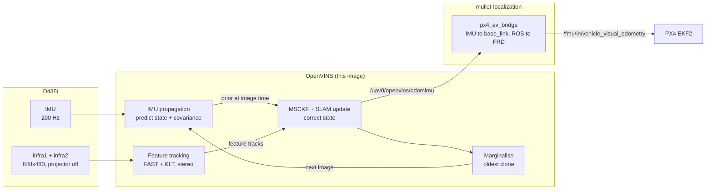
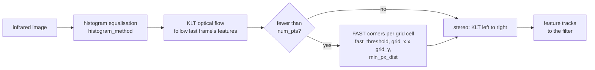
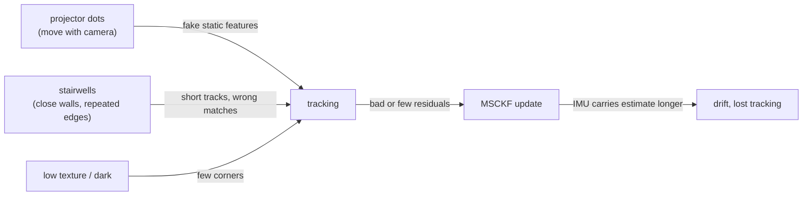

# How OpenVINS works, and how we use it

This page is for whoever tunes or debugs OpenVINS next. It covers what the estimator does, how it
starts, what it publishes, which settings we changed, and the failures we have seen.

The values a drone flies with are in
[mullet-localization](https://github.com/skymule-ai/mullet-localization) (`config/openvins/`).
This repository's `config/openvins/` is an example, mostly upstream defaults. Where the two differ,
this page says so.

## The big picture



The IMU is fast but drifts: integrating it twice turns a small bias into a large position error
within seconds. The cameras are slow but anchored to the world: a feature seen from several
places constrains where those places were. The filter lets the IMU carry the estimate between
images and lets the images correct it.

## The estimator: an MSCKF

OpenVINS is a Multi-State Constraint Kalman Filter (MSCKF): an extended Kalman filter over a sliding
window of past poses. The IMU predicts the motion, and features seen in several images over that
window correct it.

### State

```math
\mathbf{x} =
\begin{bmatrix} \mathbf{x}_I \\ \mathbf{x}_C \\ \mathbf{x}_F \\ \mathbf{x}_W \end{bmatrix},
\qquad
\mathbf{x}_I =
\begin{bmatrix} {}^I_G\bar q \\ {}^G\mathbf{p}_I \\ {}^G\mathbf{v}_I \\ \mathbf{b}_g \\ \mathbf{b}_a \end{bmatrix},
\qquad
\mathbf{x}_C =
\begin{bmatrix} {}^{I_{k-1}}_{\;G}\bar q,\ {}^G\mathbf{p}_{I_{k-1}} \\ \vdots \\ {}^{I_{k-N}}_{\;G}\bar q,\ {}^G\mathbf{p}_{I_{k-N}} \end{bmatrix}
```

| Part | Contents | Setting |
| --- | --- | --- |
| $`\mathbf{x}_I`$ IMU | orientation $`{}^I_G\bar q`$, position, velocity in the global frame $`G`$; gyro bias $`\mathbf{b}_g`$; accelerometer bias $`\mathbf{b}_a`$ | |
| $`\mathbf{x}_C`$ clones | a copy of the IMU pose at each of the last $`N`$ image times | `max_clones: 11` |
| $`\mathbf{x}_F`$ SLAM features | a few long-tracked 3D points, kept in the state | `max_slam: 50`, `feat_rep_slam` |
| $`\mathbf{x}_W`$ calibration | camera-IMU time offset $`t_d`$, camera-IMU extrinsics, camera intrinsics | `calib_cam_timeoffset`, `calib_cam_extrinsics`, `calib_cam_intrinsics` |

The covariance $`\mathbf{P}`$ covers all of it: the clones are correlated with the current IMU state,
and that correlation is what lets an old image correct the present.

The global frame $`G`$ is gravity-aligned with z up. Its origin and heading are wherever the drone
was at initialisation: VIO cannot observe absolute position or yaw.

### IMU propagation

Between images, each IMU sample moves the state forward. The measurement model is

```math
\boldsymbol{\omega}_m = \boldsymbol{\omega} + \mathbf{b}_g + \mathbf{n}_g,
\qquad
\mathbf{a}_m = \mathbf{a} + {}^I_G\mathbf{R}\,{}^G\mathbf{g} + \mathbf{b}_a + \mathbf{n}_a,
\qquad
\dot{\mathbf{b}}_g = \mathbf{n}_{wg},\quad \dot{\mathbf{b}}_a = \mathbf{n}_{wa},
```

with $`{}^G\mathbf{g} = [0,\,0,\,9.81]^\top`$ (`gravity_mag`). The accelerometer measures specific
force, so at rest it reads $`+9.81`$ upward. The kinematics it drives are

```math
{}^I_G\dot{\bar q} = \tfrac12\,\boldsymbol{\Omega}\!\left(\boldsymbol{\omega}_m - \mathbf{b}_g\right){}^I_G\bar q,
\qquad
{}^G\dot{\mathbf{p}}_I = {}^G\mathbf{v}_I,
\qquad
{}^G\dot{\mathbf{v}}_I = {}^I_G\mathbf{R}^\top\!\left(\mathbf{a}_m - \mathbf{b}_a\right) - {}^G\mathbf{g}.
```

`integration: "rk4"` integrates the mean with Runge-Kutta 4. The covariance is propagated
analytically, growing at every sample:

```math
\mathbf{P}_{k+1|k} = \boldsymbol{\Phi}_k\,\mathbf{P}_{k|k}\,\boldsymbol{\Phi}_k^\top + \mathbf{Q}_k .
```

$`\mathbf{Q}_k`$ comes from the four noise values in `kalibr_imu_chain.yaml`:

| Key | Symbol | Unit | Meaning |
| --- | --- | --- | --- |
| `accelerometer_noise_density` | $`\sigma_a`$ | m/s²/√Hz | white noise on each accelerometer sample |
| `gyroscope_noise_density` | $`\sigma_g`$ | rad/s/√Hz | white noise on each gyro sample |
| `accelerometer_random_walk` | $`\sigma_{wa}`$ | m/s³/√Hz | how fast the accelerometer bias can drift |
| `gyroscope_random_walk` | $`\sigma_{wg}`$ | rad/s²/√Hz | how fast the gyro bias can drift |

These are continuous-time densities. OpenVINS converts them to per-sample values with the sample
period $`\Delta t = 1/\texttt{update\_rate}`$:

```math
\sigma_{a,d} = \frac{\sigma_a}{\sqrt{\Delta t}},
\qquad
\sigma_{wa,d} = \sigma_{wa}\sqrt{\Delta t}
\qquad\text{(same for the gyro)}.
```

On mullet1, $`\Delta t = 5`$ ms, so $`\sigma_a = 0.07`$ means about 1 m/s² of noise per accelerometer
sample, and $`\sigma_g = 0.001`$ about 0.014 rad/s per gyro sample. Because the conversion uses
`update_rate`, it must match the real IMU rate: 200 Hz on mullet1 (`gyro_fps` in the RealSense
config). The example in this repository still says 100 Hz.

The values we use are about 20 times the commented-out ones above them. The smaller values describe
a still sensor on a bench. On a flying drone, vibration and unmodelled effects make the IMU less
trustworthy than that. Noise set too small makes the filter overconfident in the IMU, and it rejects
good visual updates. Noise set too large makes the estimate jittery and slow to correct biases.

### Feature tracking

With `use_klt: true`, each camera image goes through:



1. FAST corners (`fast_threshold`) are detected on a `grid_x` × `grid_y` grid, so features spread
   across the image instead of clustering on one textured patch. Corners closer than `min_px_dist`
   pixels are dropped.
2. KLT optical flow follows each corner from frame to frame. When features are lost, new corners are
   detected until there are `num_pts` again.
3. With `use_stereo: true`, KLT also matches each left-image feature into the right image. Stereo
   gives metric depth from one frame. Monocular VIO only gets scale from accelerometer excitation,
   and a hovering drone gives almost none.

### The MSCKF update

The window, and one feature seen from several clones:

```text
                         * f_j  (3D point, NOT in the state)
                       / | \ 
                     /   |   \        each ray = one pixel observation z_ij
                   /     |     \
   time ──►   [I_k-10] ... [I_k-2] [I_k-1] [I_k]
              └──────── clones x_C ───────┘ current IMU state x_I
              oldest: marginalised next
```

A feature that has left the view, or has been tracked across the whole window, becomes an
**MSCKF feature**:

1. **Triangulate:** its 3D position $`{}^G\mathbf{p}_{f}`$ is solved from the clone poses that saw
   it. The point is not added to the state.
2. **Linearise:** each observation is a projection of the point into camera $`C`$ at clone $`i`$,

   ```math
   \mathbf{z}_{i} = \pi\!\left({}^{C_i}\mathbf{p}_f\right) + \mathbf{n}_{i},
   \qquad
   {}^{C_i}\mathbf{p}_f = {}^C_I\mathbf{R}\;{}^{I_i}_{\;G}\mathbf{R}\left({}^G\mathbf{p}_f - {}^G\mathbf{p}_{I_i}\right) + {}^C\mathbf{p}_I,
   \qquad
   \pi\!\left([x,y,z]^\top\right) = \left[\tfrac{x}{z},\ \tfrac{y}{z}\right]^\top ,
   ```

   followed by the camera intrinsics and distortion. Stacking all $`m`$ observations and
   linearising gives a residual that depends on the state error **and** on the point's error:

   ```math
   \tilde{\mathbf{z}} \approx \mathbf{H}_x\,\tilde{\mathbf{x}} + \mathbf{H}_f\,{}^G\tilde{\mathbf{p}}_f + \mathbf{n},
   \qquad
   \mathbf{H}_f \in \mathbb{R}^{2m\times 3}.
   ```

3. **Nullspace projection:** take $`\mathbf{N}`$, a basis of the left nullspace of
   $`\mathbf{H}_f`$ ($`\mathbf{N}^\top\mathbf{H}_f = \mathbf{0}`$, $`2m-3`$ columns), and multiply
   through:

   ```math
   \underbrace{\mathbf{N}^\top\tilde{\mathbf{z}}}_{\mathbf{r}_o}
   = \underbrace{\mathbf{N}^\top\mathbf{H}_x}_{\mathbf{H}_o}\,\tilde{\mathbf{x}} + \mathbf{N}^\top\mathbf{n}.
   ```

   The point's error is gone. What remains constrains only the clones and the calibration. This is
   how an MSCKF uses many features without keeping them in the state. The cost: 3 of the $`2m`$
   equations are spent on the point, so a feature needs enough observations to be useful.
4. **Chi² gating:** a feature is kept only if its Mahalanobis distance passes

   ```math
   \gamma = \mathbf{r}_o^\top\left(\mathbf{H}_o\mathbf{P}\mathbf{H}_o^\top + \sigma_{px}^2\mathbf{I}\right)^{-1}\mathbf{r}_o
   \;<\; c\,\chi^2_{0.95}(2m-3),
   ```

   with $`\sigma_{px}`$ = `up_msckf_sigma_px` and $`c`$ = `up_msckf_chi2_multipler`. Features that
   fail are dropped as outliers: a bad track, a moving object, a projector dot.
5. **Update:** the remaining features (up to `max_msckf_in_update`) are stacked, compressed with a
   QR decomposition, and applied as one EKF update:

   ```math
   \mathbf{K} = \mathbf{P}\mathbf{H}_o^\top\left(\mathbf{H}_o\mathbf{P}\mathbf{H}_o^\top + \mathbf{R}\right)^{-1},
   \qquad
   \hat{\mathbf{x}}^+ = \hat{\mathbf{x}} \boxplus \mathbf{K}\,\mathbf{r}_o,
   \qquad
   \mathbf{P}^+ = \left(\mathbf{I} - \mathbf{K}\mathbf{H}_o\right)\mathbf{P}.
   ```

   $`\boxplus`$ is addition for vectors and a small-rotation update for quaternions.

**SLAM features** are long-tracked points kept in $`\mathbf{x}_F`$ (anchored inverse depth). They
are updated like EKF-SLAM landmarks, without the nullspace step, and they hold the estimate steady
while the drone hovers and the window sees nothing new.

### Marginalising clones

```text
 after image k:    [I_k-10] [I_k-9] ... [I_k-1] [I_k]      11 clones + new one = too many
                      │
                      ▼  features that need it are used in an update first
 marginalise:      drop its rows/columns from x and P
                      │
 after image k+1:          [I_k-9] ... [I_k-1] [I_k] [I_k+1]
```

After each image, a new clone is added. When there are more than `max_clones`, the oldest clone is
marginalised: its rows and columns are removed from the state and the covariance. Its information
stays in the correlations it built with the rest of the state. Features that depended on it are used
in an update before it goes.

### First-estimates Jacobians and observability

A VIO system has four unobservable directions: global position (3) and yaw about gravity (1). In
linear-algebra terms, the observability matrix of the true system has a 4-dimensional nullspace:

```math
\mathcal{O} = \begin{bmatrix} \mathbf{H}_1 \\ \mathbf{H}_2\boldsymbol{\Phi}_{2,1} \\ \vdots \\ \mathbf{H}_k\boldsymbol{\Phi}_{k,1} \end{bmatrix},
\qquad
\mathcal{O}\,\mathbf{N}_{\text{unobs}} = \mathbf{0},
\qquad
\mathbf{N}_{\text{unobs}} = \begin{bmatrix} \mathbf{0}_{3} & {}^I_G\mathbf{R}\,{}^G\mathbf{g} \\ \mathbf{I}_{3} & -\lfloor{}^G\mathbf{p}_I\rfloor_\times{}^G\mathbf{g} \\ \mathbf{0}_{3} & -\lfloor{}^G\mathbf{v}_I\rfloor_\times{}^G\mathbf{g} \\ \vdots & \vdots \end{bmatrix}
```

(first column block: translate everything; last column: rotate everything about gravity).

A plain EKF evaluates each $`\boldsymbol{\Phi}`$ and $`\mathbf{H}`$ at the latest estimate, and
different steps use different estimates of the same variable. The products no longer cancel, the
yaw direction drops out of the nullspace, and the filter thinks it has measured yaw. It becomes
overconfident and inconsistent: its covariance shrinks while its error does not.

`use_fej: true` evaluates each Jacobian at the **first** estimate of each state variable instead.
The nullspace keeps all four directions, and yaw and position covariance can grow as they should.
Leave it on.

## Initialisation

`init_dyn_use: false`, so OpenVINS uses its static initialiser. It needs the drone **at rest and
then lifted**:

```text
 accel std  ▲
            │                                   ╭╮  ╭─╮
   0.60 ────┼─────────────────────────────────╭─╯╰──╯ ╰──   init_imu_thresh
            │                                 │
            │  ~~~~~~~~~~~~~~~~~~~~~~~~~~~~~~~╯
            └──────────────────────────────────────────────► time
               ├──── older half: still ────┤├─ newest: jerk ─┤
               └──────────── init_window_time = 2 s ─────────┘
                  gravity dir + gyro bias      → start filter
```

1. It buffers `init_window_time` seconds (2 s) of IMU data and splits it into an older and a newer
   half.
2. It waits for a jerk: the accelerometer spread in the newer half,
   $`\sigma = \sqrt{\tfrac{1}{n-1}\sum_k \lVert\mathbf{a}_k - \bar{\mathbf{a}}\rVert^2}`$, must exceed
   `init_imu_thresh` (0.60 m/s²) while the older half stayed below it. `init_max_disparity` also
   checks the images for stillness.
3. From the still half it takes the mean readings. Gravity gives roll and pitch, and the gyro mean
   is the bias:

   ```math
   {}^I\hat{\mathbf{z}}_G = \frac{\bar{\mathbf{a}}_m}{\lVert\bar{\mathbf{a}}_m\rVert}
   \;\Rightarrow\; {}^I_G\mathbf{R}\ \text{(yaw} = 0\text{)},
   \qquad
   \mathbf{b}_g = \bar{\boldsymbol{\omega}}_m .
   ```

   Position, velocity and yaw start at zero.

`no accel jerk detected` in the log means it has a still window and is waiting for the motion. Lift
or nudge the drone. If it never initialises, check that the IMU topic is arriving at the expected
rate. If it initialises while moving, the gravity direction is wrong and the estimate tilts and
drifts from the start.

## Our use

### What OpenVINS publishes

`/uav0/openvins/odomimu` (`nav_msgs/Odometry`):

- **Pose:** the D435i IMU in the global frame (gravity-aligned, z up, heading from start-up).
- **Twist:** linear and angular velocity of the IMU, in the IMU frame (the child frame).
- **Axes:** the D435i IMU uses the camera's optical axes: x right, y down, z forward. It is not FLU.

```text
   D435i IMU (optical)          base_link (FLU, ROS)          base_link (FRD, PX4)

          z (forward)                  z (up)
         ↗                             ▲   x (forward)              ↗ x (forward)
        ●──► x (right)                 │ ↗                         ●──► y (right)
        │                     y ◄──────●                           │
        ▼ y (down)            (left)                               ▼ z (down)
```

### How mullet-localization hands it to PX4

mullet-localization remaps `odomimu` to `localization/odometry`. Its `px4_ev_bridge`
(`mullet_localization/frames.py`, `to_px4`) converts it in two steps.

**1. IMU to base_link.** `config/ev_bridge.yaml` gives base_link's pose in the IMU frame: the lever
arm $`{}^I\mathbf{t}_B`$ (`body_t_base`) and the rotation $`\bar q_{IB}`$ (`body_q_base`, optical
axes to FLU). With $`\mathbf{R} = {}^G_I\mathbf{R}`$ the IMU attitude from OpenVINS:

```math
{}^G\mathbf{p}_B = {}^G\mathbf{p}_I + \mathbf{R}\,{}^I\mathbf{t}_B,
\qquad
\bar q_{GB} = \bar q_{GI}\otimes\bar q_{IB},
\qquad
{}^G\mathbf{v}_B = \mathbf{R}\left({}^I\mathbf{v}_I + {}^I\boldsymbol{\omega}\times{}^I\mathbf{t}_B\right),
\qquad
{}^B\boldsymbol{\omega} = \mathbf{R}_{IB}^\top\,{}^I\boldsymbol{\omega}.
```

The $`\boldsymbol{\omega}\times\mathbf{t}`$ term is why the lever arm matters: the camera sits
15 cm ahead of the CoM, so a 1 rad/s yaw moves it at 0.15 m/s while the CoM stays still. Because
the lever arm is applied here, `EKF2_EV_POS_X/Y/Z` stay 0.

**2. ROS to PX4 frames.** World z-up to FRD and body FLU to FRD are both a 180° rotation about x,
$`\mathbf{F} = \operatorname{diag}(1,-1,-1)`$:

```math
\mathbf{p}_{\text{FRD}} = \mathbf{F}\,{}^G\mathbf{p}_B,
\qquad
\mathbf{v}_{\text{FRD}} = \mathbf{F}\,{}^G\mathbf{v}_B,
\qquad
\boldsymbol{\omega}_{\text{FRD}} = \mathbf{F}\,{}^B\boldsymbol{\omega},
\qquad
(w,x,y,z)_{\text{FRD}} = (w,\,x,\,-y,\,-z).
```

The bridge publishes `POSE_FRAME_FRD` and `VELOCITY_FRAME_FRD`, with variances taken from the
covariance diagonals.

By default the bridge runs in shadow mode: it publishes to `localization/vehicle_odometry` and PX4
gets nothing. The PX4 side is set by profiles in mullet-px4. The mullet-localization README covers
it.

## The settings we changed, and why

| Setting | Example (this repo) | mullet1 | Why |
| --- | --- | --- | --- |
| `calib_cam_intrinsics` | `true` | `false` | We feed the rectified `image_rect_raw` streams with factory intrinsics. Refining intrinsics online adds weakly observable states that can wander. |
| `calib_cam_timeoffset` | `false` | `true` | The camera and IMU timestamps are not perfectly aligned. The offset is observable during normal flight, and an error of a few ms becomes a pose error under fast rotation. |
| `update_rate` (IMU) | `100.0` | `200.0` | Matches the real gyro rate. The per-sample noise depends on it. |
| IMU noise densities | inflated | inflated | See [IMU propagation](#imu-propagation). |

Why the time offset matters: an image stamped $`t_d`$ late is matched to the pose at the wrong time.
The resulting angle error is $`\delta\theta \approx \lVert\boldsymbol{\omega}\rVert\,t_d`$, so at
2 rad/s a 5 ms offset is 0.01 rad, about 4 px at mullet1's 424.5 px focal length (848x480),
well above `up_msckf_sigma_px` (1.2 px).

`calib_cam_extrinsics` stays `false` in both. The camera-IMU extrinsics come from the factory TF,
and estimating them online is unreliable during near-degenerate motion such as hover.

We have not changed these yet. They are the first ones to try when tracking is poor:

| Setting | Value | Effect |
| --- | --- | --- |
| `num_pts` | 200 | Features per camera. More gives more constraints in low texture, at a CPU cost on the Orin. |
| `fast_threshold` | 30 | FAST corner strength. Lower finds corners on low-contrast surfaces, but also finds noise. |
| `histogram_method` | `HISTOGRAM` | Equalisation before tracking. `CLAHE` handles uneven light (windows, shadows) better, at a small cost. |

## Failure modes seen on mullet1

What breaks VIO, by where it enters the pipeline:



- **Infrared projector dots (measured).** The D435i projector paints a dot pattern that moves with
  the camera. OpenVINS tracks the dots as fixed points, and chi² gating does not catch them all.
  Indoors and near walls this causes drift and lost tracking: 4.5% drift with the projector on and
  1.4% off on the same 2026-10-16 office walk. Keep it off: `depth_module.emitter_enabled: 0`, as an
  integer. See the [README](../README.md#d435i-infrared-projector).
- **Stairwells.** Close walls, fast changes of view and repeated edges (steps, railings) shorten
  feature tracks and cause wrong KLT matches. With fewer MSCKF updates, the IMU carries the estimate
  for longer. We have no isolated measurement of this yet.
- **Low texture.** On blank walls, floors and dark rooms, FAST finds few corners, so updates become
  sparse. IMU-only drift then grows quickly, because a bias error is integrated twice:
  $`\delta p(t) \approx \tfrac12\,\delta b_a\,t^2`$, so a 0.05 m/s² bias error is 0.6 m after 5 s.
  Turning the projector back on does not help VIO (see above). Try `fast_threshold`, `num_pts` and
  `histogram_method`. We have no isolated measurement of this yet.

## Further reading

- P. Geneva, K. Eckenhoff, W. Lee, Y. Yang, G. Huang, "OpenVINS: A Research Platform for
  Visual-Inertial Estimation", ICRA 2020.
- A. I. Mourikis, S. I. Roumeliotis, "A Multi-State Constraint Kalman Filter for Vision-aided
  Inertial Navigation", ICRA 2007.
- G. P. Huang, A. I. Mourikis, S. I. Roumeliotis, "Observability-based Rules for Designing
  Consistent EKF SLAM Estimators", IJRR 2010 (first-estimates Jacobians).
- [docs.openvins.com](https://docs.openvins.com): the propagation, update, FEJ and initialisation
  pages derive everything above in full.
